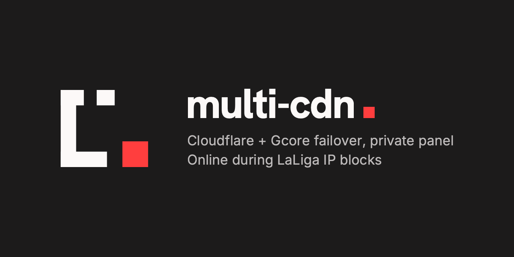

<p align="center"></p>

<p align="center">
  <a href="https://github.com/Pepebits/multi-cdn/actions/workflows/ci.yml"></a>
  <a href="https://hub.docker.com/r/pepebits/multi-cdn"></a>
  <a href="LICENSE"></a>
</p>

🛡️ Keeps your sites online during Cloudflare IP blocks by failing over to Gcore,
**without ever publishing your server's IP**.

## 🤔 Why

In Spain, ISPs block ranges of Cloudflare IPs by court order during LaLiga matches, and
every unrelated site behind those IPs goes down with them. The usual workaround, turning off
Cloudflare's proxy, publishes your server's IP for good.

multi-cdn moves each domain to a second CDN instead ⚡ before or as soon as its Cloudflare
IPs are blocked, and moves it back when the block is over. You get a Telegram message each
time.

## ✨ Features

- 📡 **Watches the blocks**: the public block feed by ISP ([hayahora.futbol](https://hayahora.futbol)),
  mass-block detection and the LaLiga match calendar.
- 🔀 **Switches on its own**: per domain, only when its IPs are blocked (*reactive*), also
  before matches (*preventive*), or never, just alerts (*manual*). It comes back to
  Cloudflare after 15–20 min without blocks. ⏱️ Both times are configurable, with defaults
  taken from two months of real block history.
- 🔒 **Never exposes the origin**: a hostname is always proxied by Cloudflare or a CNAME to
  Gcore. The code refuses any DNS change that would reveal your IP.
- ☁️ **Gcore ready in advance**: certificate, CDN resource and origin, prepared with one
  click and checked on every edge before a switch.
- 🧱 **Origin firewall**: only the CDNs can reach ports 80/443, plus a secret header so
  nobody else can use a CDN to reach your server.
- 🔔 **Alerts**: Telegram, email and an external heartbeat if the panel itself goes down.
- 📊 **Statistics**: blocks, switches and Gcore traffic against its free quota.
- 🌍 **English and Spanish**: the panel follows your browser; switch in the footer.

## 🚀 Get started

You need a Linux server with Docker, your domains on Cloudflare, and a free
[Gcore](https://gcore.com) account. Nothing touches your DNS until the last step.

**1️⃣ Install** on your server:

```bash
git clone https://github.com/Pepebits/multi-cdn.git
cd multi-cdn
deploy/install.sh
```

It creates `.env` and prints a **master key**. 🔑 Save it in your password manager.

**2️⃣ Configure**: open `.env` and fill in your server's IP and your email:

```bash
nano .env      # ORIGIN_VPS1_IPV4=…  MULTICDN_ACME_EMAIL=…
```

**3️⃣ Start** the panel:

```bash
deploy/install.sh
```

**4️⃣ Create your user**: it asks for a password and shows a QR for your authenticator app:

```bash
docker compose exec panel python -m app.cli create-user <user>
```

**5️⃣ Open the panel** from your computer through an SSH tunnel:

```bash
ssh -N -L 8765:127.0.0.1:8765 <user>@<server>
```

Then go to <http://localhost:8765> and sign in.

> ⚠️ Never publish the panel through Cloudflare: during a block, that is exactly what goes
> down.

**6️⃣ Follow the checklist** on the panel's overview 📋:

1. Connect Cloudflare and Gcore (API tokens)
2. Add your origin server
3. Import your domains
4. Prepare each domain on Gcore
5. Set up Telegram or email alerts

**7️⃣ Protect your server** with the firewall and Caddy snippets in
[`deploy/`](deploy/README.md#9-protect-the-origin) 🧱.

**8️⃣ Go live** ✅: everything is a simulation until you set this in `.env` and restart:

```bash
MULTICDN_DRY_RUN=false
```

```bash
docker compose up -d
```

📖 Every step in detail, with the exact token permissions: **[deployment guide](deploy/README.md)**.

## 🆘 When the panel is down

Switch from the server's terminal, with the same safeguards as the panel:

```bash
docker compose exec panel python -m app.cli status                    # where each domain is
docker compose exec panel python -m app.cli switch example.com gcore  # or: cloudflare
```

## 🐳 Docker image

`ghcr.io/pepebits/multi-cdn` or `pepebits/multi-cdn` on Docker Hub: Alpine, non-root,
read-only filesystem, amd64 and arm64, with SBOM and provenance. `compose.yaml` uses it
directly, so you can also run without cloning: download `compose.yaml` and `.env.example`
(as `.env`), set `MULTICDN_SECRET_KEY`, then `docker compose up -d`.

## 🛠️ Develop

```bash
cp .env.example .env
uv sync
uv run pytest
uv run python -m app.cli create-user <user>
uv run uvicorn app.main:app --host 127.0.0.1 --port 8765
```

FastAPI with server-rendered templates, no frontend build. SQLite for inventory, encrypted
credentials, history and engine state. Interface texts are English in the code, with the
Spanish catalog in `app/locale/es/` (a test checks that nothing is missing). Examples and
tests only use `example.com` and documentation IPs.

## 🔐 Security

- Password + mandatory TOTP, recovery codes, short sessions and lockouts. The first user can
  only be created from the server's terminal.
- CSRF tokens, `Origin` checks and a strict CSP without inline scripts.
- Provider tokens and the origin IP are encrypted at rest with a key kept outside the
  database, and never shown again.

Found a vulnerability? Report it privately through
[GitHub security advisories](https://github.com/Pepebits/multi-cdn/security/advisories/new),
not in issues.

## 🎨 Design

Neo-brutalist system shared with the other Pepebits products ([`DESIGN.md`](DESIGN.md)),
audited with axe-core and Lighthouse in light and dark themes.

## 📄 License

[Apache 2.0](LICENSE) · a [Pepebits](https://pepebits.com) product.
